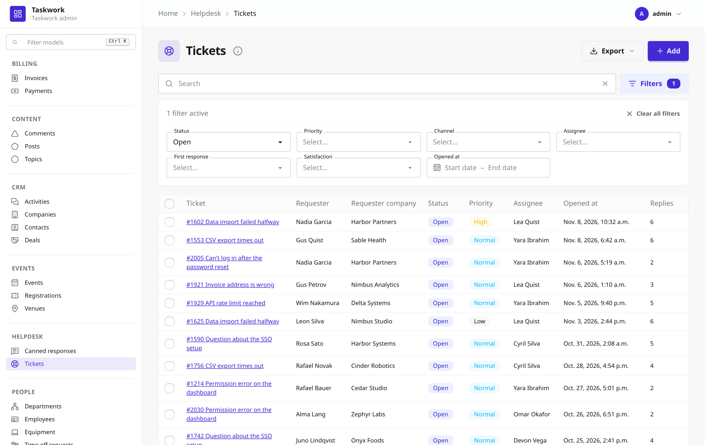
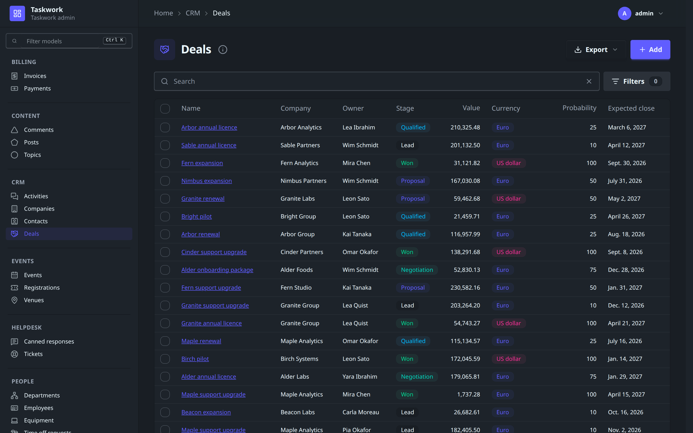
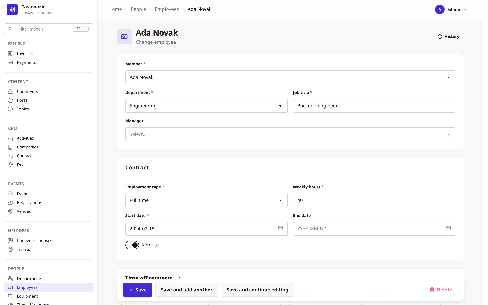
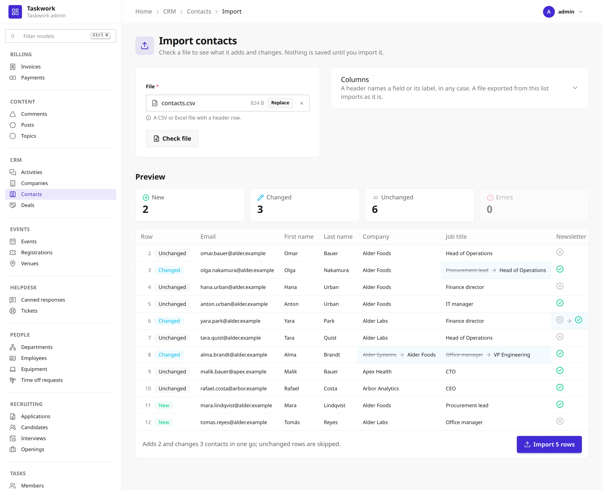

# Admin

`django_formwork.admin` is a Django admin built on formwork forms, django-filter, htmx
and Jinja2, styled with DaisyUI. It keeps the names, options, hooks, URL names and
permissions of `django.contrib.admin`, so most `admin.py` modules port by changing one
import:

```python
# from django.contrib import admin
from django_formwork import admin


@admin.register(Ticket)
class TicketAdmin(admin.ModelAdmin):
    list_display = ["subject", "requester", "status", "priority"]
    list_filter = ["status", "opened_at"]
    search_fields = ["subject", "requester__email"]
    inlines = [ReplyInline]
```



The classes are its own. A `ModelAdmin` does not subclass Django's, so an admin class
written for `django.contrib.admin` that calls into Django's internals needs changes.

!!! warning "Experimental"
    The admin is new and its API can change in any release before 1.0.

## Setup

### 1. Install

```bash
pip install "django-formwork[admin]"
```

The `admin` extra installs django-filter and Jinja2.

### 2. Settings

```python
INSTALLED_APPS = [
    ...,
    "django.contrib.admin",  # the history log (LogEntry)
    "django.contrib.auth",
    "django.contrib.contenttypes",
    "django.contrib.messages",
    "django.contrib.staticfiles",
    "django.forms",
    "django_iconx",
    "django_formwork",
    "django_formwork.admin",
]

MIDDLEWARE = [
    "django.contrib.sessions.middleware.SessionMiddleware",
    "django.contrib.auth.middleware.AuthenticationMiddleware",
    "django.contrib.messages.middleware.MessageMiddleware",
    ...,
]
```

The admin writes its history to Django's `LogEntry`, so `django.contrib.admin` must be
installed. Its system checks also ask for a `DjangoTemplates` backend with the `request`,
`auth` and `messages` context processors. The admin pages themselves render through a
private Jinja2 engine, so `TEMPLATES` needs no Jinja2 backend.

Run `manage.py migrate` after you add the app.

`manage.py check` reports a missing app or middleware, and checks every registered
`ModelAdmin` for the mistakes Django's admin checks catch, under the same numbers:
`formwork_admin.E108` for an unknown `list_display` entry, `formwork_admin.E116` for a
broken `list_filter` entry, and so on.

### 3. URLs

```python
from django.urls import include, path

from django_formwork.admin import site

urlpatterns = [
    path("__formwork__/", include("django_formwork.urls")),
    path("admin/", site.urls),
]
```

`django_formwork.urls` serves the relation search of the dropdowns. The site's URL
names match Django's, so `reverse("admin:helpdesk_ticket_change", args=[ticket.pk])` works as
before. To run Django's admin next to this one, give one of the two sites another
`name`, since both use the `admin` namespace by default.

### 4. CSS

Import `admin.css` after `formwork.css` in your Tailwind entry and build it as in
[Installation](../getting-started/installation.md#4-build-the-css):

```css
@import "path/to/site-packages/django_formwork/static/formwork/formwork.css";
@import "path/to/site-packages/django_formwork/admin/static/formwork_admin/admin.css";
@import "./static/iconx/icons.css" layer(components);
```

`admin.css` registers the admin's templates with `@source`, so Tailwind finds their
classes. Then point the site at the built file:

```python
# myproject/admin_site.py
from django_formwork.admin import AdminSite


class MyAdminSite(AdminSite):
    site_header = "Helpdesk"
    stylesheets = ("dist.css",)
```

```python
# settings.py
FORMWORK_ADMIN_SITE = "myproject.admin_site.MyAdminSite"
```

The navigation and the actions use Lucide icons, so run `manage.py formwork install`
once, as for the widgets.

### 5. Scripts

The site loads htmx 4, its Alpine bridge and Alpine.js from a CDN. To serve them
yourself, override `scripts` (htmx and the bridge) and `alpine_script` on your site
class.

## The site

`django_formwork.admin.site` is the default site. `FORMWORK_ADMIN_SITE` names its class,
and every app's `admin` module is imported at startup (`FORMWORK_ADMIN_AUTODISCOVER`
changes the module name). Attributes of `AdminSite` that Django's site does not have:

| Attribute | Default | Description |
|---|---|---|
| `stylesheets` | `("formwork/formwork-dist.css",)` | Static paths of the built CSS. |
| `scripts` | htmx 4 and `hx-alpine-compat` | Scripts loaded before the admin's own. |
| `alpine_script` | Alpine.js 3.15 | Loaded last, with `defer`. |
| `themes` | `("light", "dark")` | The DaisyUI themes the theme menu offers. The first is the default. |

`site_title`, `site_header`, `index_title`, `site_url`, `empty_value_display`,
`enable_nav_sidebar`, `login_form`, `password_change_form`, the `*_template` attributes,
`each_context()`, `get_app_list()`, `admin_view()`, `has_permission()`, `add_action()`
and `disable_action()` work as in Django.



## ModelAdmin

The list, add, change, delete and history pages read the same options as Django's
admin: `list_display`, `list_display_links`, `list_filter`, `list_select_related`,
`list_per_page`, `list_max_show_all`, `list_editable`, `search_fields`,
`search_help_text`, `date_hierarchy`, `ordering`, `sortable_by`, `fields`, `exclude`,
`fieldsets`, `readonly_fields`, `prepopulated_fields`, `radio_fields`,
`autocomplete_fields`, `raw_id_fields`, `formfield_overrides`, `form`, `inlines`,
`actions`, `save_as`, `save_on_top`, `preserve_filters`, `view_on_site`, the
`has_*_permission()` methods, and the `get_*()`, `save_model()`, `save_formset()`,
`delete_model()` and `response_*()` hooks.

The forms are formwork forms, so every field renders with formwork's widgets and
templates. A relation gets a `Select` or `SelectMultiple`, a date field a `DatePicker`,
and a datetime field a `DatePicker` with a time input next to it. As in Django's admin,
a date is typed in the first format of the language's `DATE_INPUT_FORMATS`, for example
`10.01.2026` in German, and the date filter writes its dates the same way. Lists and
read-only fields show `DATE_FORMAT` and `DATETIME_FORMAT`.

After a failed save, each field error shows under its field, as in Django's admin. A
`form` whose `Meta.error_display` is set keeps that display.



Options this admin adds:

| Option | Description |
|---|---|
| `icon` | The Lucide icon next to the model in the navigation and the page title. Unset, the model gets a placeholder shape, see below. |
| `list_badges` | Badge colors per value, by column: `{"status": {"active": "success", "archived": "warning"}}`. |
| `list_only_fields` | Load only these columns on the list page. |
| `list_defer_fields` | Skip these columns on the list page, for a large JSON or text column that no column shows. |

`list_only_fields` is opt-in. A `__str__` that reads a deferred field runs one query per
row.

A model without an `icon` gets a plain shape instead: a circle, triangle, square, diamond,
pentagon, hexagon or star. The shape comes from a hash of the model's label, so it stays
the same across restarts, and the models of one app get different shapes while there
are no more than seven of them. Set `icon` on the models you want to tell apart at a
glance and leave the rest to the shapes.

### Related objects

Next to a relation, the change form has buttons that open the related model's admin in
a dialog. Django's admin opens a popup window for the same buttons.

- **Add another** (plus) adds a row. After the save, the dialog closes and the field
  chooses the new row. The other fields on the page that point to the same model list
  the row too, unless they limit their choices.
- **Change selected** (pencil) edits the chosen row, and the field shows its new name.
  With only the view permission, the button is an eye and shows the row. Without a
  chosen row, the button stays in place, dimmed. A many-to-many field has no such
  button.

Each button shows only with the matching permission on the related model's admin. There
is no delete button: delete a row in its own admin.

A relation in the dialog opens the next dialog on top. <kbd>Esc</kbd> or the close
button closes a dialog, and the browser asks first when its form has unsaved changes.
A click with <kbd>Ctrl</kbd> or <kbd>Cmd</kbd>, or with the middle button, opens the
page in a new tab instead.

The dialog loads Django's popup URLs, with `_popup=1` and `_to_field`, so a
`response_add()`, `response_change()` or `response_delete()` that checks for `_popup`
keeps working. A save in the dialog ends on `popup_response_template`, by default
`formwork_admin/popup_response.html`. An override keeps the element with the id
`formwork-admin-popup-response`: the dialog reads the saved row from its
`data-popup-response` attribute.

### Filters

The filter bar is a django-filter `FilterSet` that the admin builds from `list_filter`.
An entry can be:

- a field name. Choices, booleans and relations get a dropdown, dates a range picker.
  Its calendar has the ranges of Django's date filter: Today, Past 7 days, This month
  and This year.
- a `SimpleListFilter` subclass, as in Django.
- a tuple such as `("field", admin.EmptyFieldListFilter)` or
  `("category", admin.RelatedOnlyFieldListFilter)`.
- a `django_filters.Filter` with its `field_name` set, for any lookup django-filter
  supports. A `django_filters.RangeFilter` shows a min and a max input in one field.

The filters sit in a row under the search box, in the order of `list_filter`. The
Filters button opens the row and shows how many filters are active. The row is open
when the page loads with an active filter. A list without `list_filter` keeps the button
in the same place, and its row says that the list has no filters.

The search box filters the same way, through `get_search_results()`, so `^`, `=` and `@`
prefixes in `search_fields` work as in Django. A filter on a many-to-many relation picks
one row, as Django's related filter does.

The list updates as the user types or picks, and the URL keeps every filter, the
search, the sort and the page.

With `show_facets` at its default, `admin.ShowFacets.ALLOW`, the filter row has a Show
counts switch. The switch adds `_facets` to the URL, as Django's link does, and each
option then shows how many rows it matches. The count applies the search and the other
filters, but not the filter of the option itself. `ShowFacets.ALWAYS` shows the counts
without the switch, and `ShowFacets.NEVER` removes both.

```python
@admin.register(Project)
class ProjectAdmin(admin.ModelAdmin):
    list_filter = ("status", "owner")
    show_facets = admin.ShowFacets.ALWAYS
```

Each filter with counts runs one more query. Date and number ranges have no counts. A
relation filter that searches its rows on the server shows counts only while all rows
fit on its first page of 20.

### Columns

When the columns of `list_display` do not fit the width of the list, the list hides
columns from the right and shows a "+N" button at the end of the header. The checkbox,
the first column and the columns of `list_display_links` always show. The tooltip of
the button names the hidden columns.

The button shows all columns. The table then scrolls sideways, and the checkbox and the
first column stay in view. The browser stores the choice per model, so the list opens
the same way next time.

A `list_editable` error in a hidden column shows all columns and scrolls the first error
into view. Without JavaScript, the table scrolls sideways as in Django's admin.

### Info dialog

The info button next to the list's title opens a dialog about the model:

- the row count, from the same paginator as the list, so a large PostgreSQL table
  shows its estimate.
- every entry of `search_fields` with its label and how a word matches: contains,
  starts with, is or full text. `search_help_text` shows above them.
- every field with its type, the related model and flags such as unique, indexed or
  null, and the list's default order.

A superuser also sees the table: its name, the database and its version, the model
and admin classes, the indexes and constraints the database has, and the size of the
rows and the indexes on PostgreSQL, MySQL and on SQLite builds with the `dbstat`
table. The dialog loads from the
`info/` URL the first time it opens, so the list page runs no extra queries. Override
`formwork_admin/change_list_info.html` to change what it shows.

### Actions

`@admin.action` takes two more arguments:

```python
@admin.action(description="Archive selected tickets", icon="archive", danger=True)
def archive(self, request, queryset): ...
```

`icon` names a Lucide icon for the action bar, and `danger` draws the button in the
error color. Actions run as in Django: a function gets `(modeladmin, request, queryset)`
and a name resolves to a method of the admin. The bar appears when a row is selected,
and shift-click selects a range.

### Inlines

`TabularInline` and `StackedInline` take Django's options (`extra`, `min_num`,
`max_num`, `fk_name`, `can_delete`, `show_change_link`, `classes`, `formset`). Rows are
added and removed in the browser, and the formset indexes stay contiguous.

### Export

The Export menu next to the add button writes the list as a CSV, Excel or JSON file. The
file holds every row that the filters and the search let through, in the list's sort
order, not only the current page.

```python
@admin.register(Ticket)
class TicketAdmin(admin.ModelAdmin):
    export_fields = ["id", "subject", "requester__email", "status", "opened_at", "age"]
    export_formats = ("csv", "xlsx")
```

| Option | Default | Description |
|---|---|---|
| `export_fields` | every field | The columns: field names, `__` lookups, admin methods and callables, as in `list_display`. |
| `export_formats` | `("csv", "xlsx", "json")` | The formats the menu offers. An empty tuple hides the menu. |
| `export_background_threshold` | `5000` | Above this many rows the export runs as a task. `None` keeps every export in the request. |

A foreign key exports the primary key of the related row, a many-to-many field the
sorted primary keys. Excel keeps numbers, dates and booleans as such. JSON writes dates
and decimals as text, as `DjangoJSONEncoder` does. A JSON field stays structured in JSON
and becomes JSON text in CSV and Excel. Excel shows
a datetime in the site's time zone, since Excel has no time zones. The CSV file starts
with a byte order mark, so Excel reads it as UTF-8.

Excel files need openpyxl. Without it, the menu leaves Excel out.

Whoever can see the list can export it. `has_export_permission()` changes that, and
`get_export_fields()`, `get_export_queryset()` and `get_export_formats()` take the
request like the other `get_*()` hooks. A new format subclasses `formats.FileFormat`,
implements `write()` and `read()`, and goes into `formats.FORMATS` under its `name`.

#### Large exports

Above `export_background_threshold`, the admin saves an `ExportJob` and queues it on
Django's task framework after the request's transaction commits. The list then shows a
message with a link to the Exports page. That page is in the account menu. It lists the
user's last 50 exports and refreshes while one still runs. The file goes to the default
storage under `formwork_admin/exports/`, and only the user who started the export can
download it.

The job runs as that user with the list's filters, search and sort, so a
`get_queryset()` that limits the rows per user limits the file too.

Django's default task backend, `ImmediateBackend`, runs the job inside the request, so
the file is ready when the list loads again. For a real background run, set `TASKS` to
a backend with a worker. To use another queue, override `enqueue_export()` on your site:

```python
from celery import shared_task

from django_formwork.admin import AdminSite
from django_formwork.admin.exports import run_export_job


@shared_task
def run_admin_export(job_id):
    run_export_job(job_id)


class MyAdminSite(AdminSite):
    def enqueue_export(self, job):
        run_admin_export.delay(job.pk)
```

The admin does not delete old exports. `ExportJob.delete()` deletes the row and its
file.

### Import

Import is off by default. `import_formats` turns it on and adds an Import button next
to the Export menu:

```python
@admin.register(Contact)
class ContactAdmin(admin.ModelAdmin):
    import_formats = ("csv", "xlsx")
    import_id_fields = ["email"]
```

| Option | Default | Description |
|---|---|---|
| `import_formats` | `()` | The formats the Import page reads. An empty tuple hides the button. |
| `import_fields` | the add form's fields | The fields a row sets. Unset, the fields of the add form without the read-only and file fields. |
| `import_id_fields` | the primary key | The fields that find the record a row changes. |

The import page checks a file before it saves anything. Pick a file and click Check
file. The preview counts the new, changed, unchanged and invalid rows, and a click on a
count shows only those rows. A changed cell shows the old and the new value, and an
invalid cell shows its error as in `list_editable`. Import saves the rows in one
transaction and goes back to the list with a summary. While a row has an error, the
Import button stays off: fix the file and check it again.



How the file maps to records:

- A header matches a field by its name or its label, in any case. Other columns are
  listed as ignored, so a file exported from the list imports as it is.
- A row whose `import_id_fields` match a record changes that record. A row without a
  match, or with an empty key, adds a new one. Two rows for the same record are an
  error.
- A foreign key column holds the primary key, as the export writes it. A header such as
  `category__name` finds the record by that field instead. A many-to-many column holds
  the keys separated by commas, and `tags__slug` works the same way. A value that
  matches no record or several records is an error.
- A choice column takes the stored value or the label. A boolean column takes `true`
  and `false` or `yes` and `no`.
- A column the file leaves out keeps the record's value on a changed row and gets the
  field's default on a new row. Records the file does not mention stay as they are. An
  import never deletes.
- A row that matches its record is skipped: it is not saved and not logged.

Each row runs through the admin's form in a formwork model formset, so the form's
validation applies. Unique fields are checked across the whole file: two rows with the
same email get the error Django would give, with one query per check instead of one per
row. Saving goes through `save_form()`, `save_model()` and `save_related()`, so an
override that sets an owner still runs. Each saved row gets a history entry with
Django's change message.

The formats:

- CSV in UTF-8, with or without a byte order mark, or in Windows-1252. The delimiter is
  a comma, a semicolon or a tab, whichever the header row has most of. In a file with
  semicolons, a number can use a decimal comma, as a German Excel saves it.
- Excel reads the first sheet. It needs openpyxl.
- JSON reads a list of objects.

Whoever can add or change records can import. Each row is checked again: a new row
needs `has_add_permission()`, a changed row `has_change_permission()` on its record. A
row that fails gets an error. `has_import_permission()`, `get_import_formats()`,
`get_import_fields()`, `get_import_id_fields()` and `get_import_form()` take the request
like the other hooks.

The import keeps no copy of the file between the check and the import. Import sends the
file again, and the server checks it again. If the file or the records changed since the
check, the page shows the new preview instead of importing. The import runs in the
request, so a very large file is better split. The preview shows up to 1,000 rows:
the ones with errors first, then the changed and the new ones. The counts cover every
row.

## Users and groups

With `django.contrib.auth` installed, the site registers admins for `User` and `Group`,
as `django.contrib.auth.admin` does on Django's own site. They work as Django's do:

- Add user asks for a username and a password, or turns password-based authentication
  off. The save opens the change form of the new user for the other fields.
- The change form shows the algorithm and the parameters of the password hash. Its
  button opens a page that sets a new password or turns password-based authentication
  off.
- To add a user, the "Change user" permission is necessary too, because a user who can
  add users can add a superuser.
- The permissions of a group or a user are grouped by model.

When `AUTH_USER_MODEL` names another model, only `Group` is registered. For a model that
extends `AbstractUser`, subclass `UserAdmin`:

```python
from django_formwork import admin
from django_formwork.admin.auth import UserAdmin

from .models import Account


@admin.register(Account)
class AccountAdmin(UserAdmin):
    list_display = ("username", "email", "is_staff")
```

`User` and `Group` are registered before the `admin` modules of the apps are imported,
so an app can replace them:

```python
from django.contrib.auth.models import Group, User

from django_formwork import admin
from django_formwork.admin.auth import UserAdmin

admin.site.unregister(Group)
admin.site.unregister(User)


@admin.register(User)
class StaffUserAdmin(UserAdmin):
    list_filter = ("is_active",)
```

`django_formwork.admin.auth` also has `UserChangeForm`, `AdminUserCreationForm` and
`AdminPasswordChangeForm` for `form`, `add_form` and `change_password_form`, and
`GroupAdmin`. `change_user_password_template` names the template of the password page.

## Templates

Every page is a Jinja2 template under `formwork_admin/`, loaded from the `jinja2/`
directory of each installed app. To override one, put a template with the same path in
an app listed before `django_formwork.admin`:

```
myapp/jinja2/formwork_admin/change_list.html
```

`change_list_template`, `change_form_template` and the other `*_template` options name
Jinja2 templates of the same engine.

## Performance

- A foreign key column joins only its own relation. Django's admin calls
  `select_related()` without arguments for one, which follows every non-null relation
  five levels deep.
- A relation to a model whose admin has `search_fields` pages its rows from the server.
  The change form no longer loads the whole related table into a `<select>`.
- Without filters, the list counts a PostgreSQL table of more than 10,000 rows from the
  planner's estimate instead of `COUNT(*)`. Any filter or search counts exactly.
  `EstimatedCountPaginator.estimate_threshold` sets the limit.
- A search or filter that can return a row twice keeps the rows unique with a primary
  key subquery instead of `DISTINCT` over every column.
- The filter bar, the search and the paging swap only the list, without a full page
  load.

## Keyboard

| Keys | Action |
|---|---|
| <kbd>Ctrl</kbd>+<kbd>K</kbd> | Filter the navigation |
| <kbd>/</kbd> | Focus the list search |
| <kbd>Ctrl</kbd>+<kbd>S</kbd> | Save and continue editing |

## Not supported yet

- The raw ID lookup popup. A relation in `raw_id_fields` gets the searchable dropdown,
  with the add and change buttons.
- The add and change buttons for a relation in `radio_fields`.
- Prepopulated fields in inline rows.
