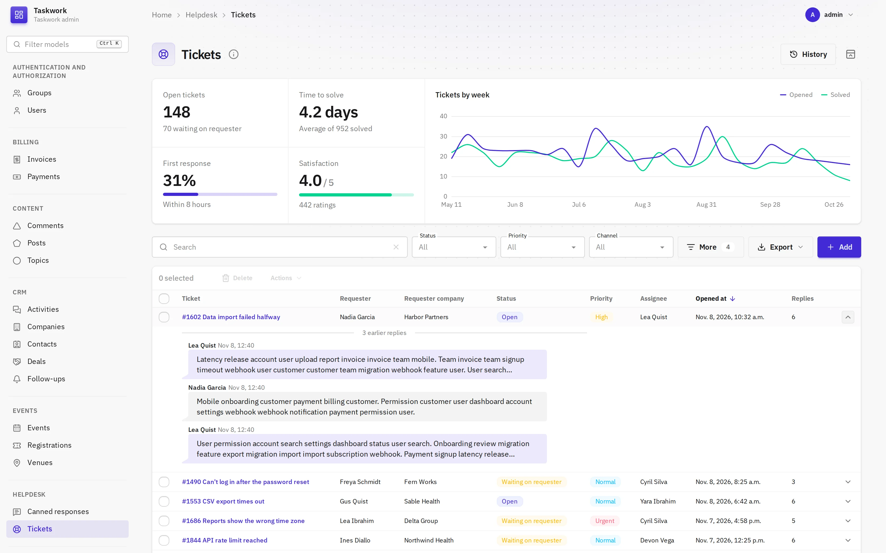
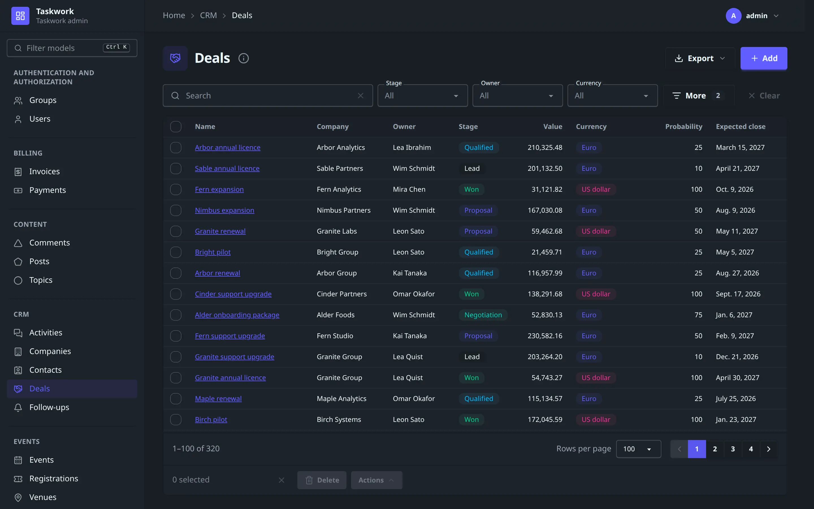
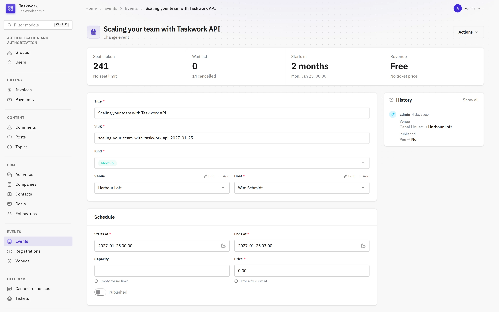
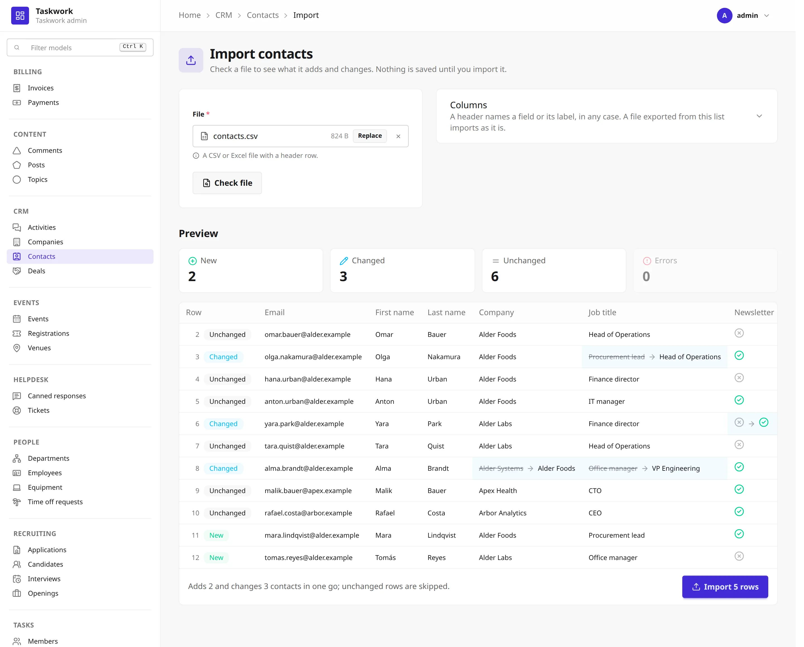
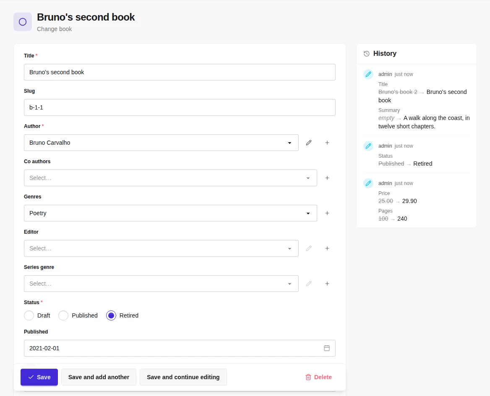

# Admin

`django_formwork.admin` is a Django admin built on formwork forms, django-filter, htmx
and Jinja2, styled with DaisyUI. It keeps the names, options, hooks, URL names and
permissions of `django.contrib.admin`, so most `admin.py` modules port by changing one
import:

```python
# from django.contrib import admin
from django_formwork import admin


@admin.register(Ticket)
class TicketAdmin(admin.ModelAdmin):
    list_display = ["subject", "requester", "status", "priority"]
    list_filter = ["status", "opened_at"]
    search_fields = ["subject", "requester__email"]
    inlines = [ReplyInline]
```



The classes are its own. A `ModelAdmin` does not subclass Django's, so an admin class
written for `django.contrib.admin` that calls into Django's internals needs changes.

!!! warning "Experimental"
    The admin is new and its API can change in any release before 1.0.

## Setup

### 1. Install

```bash
pip install "django-formwork[admin]"
```

The `admin` extra installs django-filter and Jinja2.

### 2. Settings

```python
INSTALLED_APPS = [
    ...,
    "django.contrib.auth",
    "django.contrib.contenttypes",
    "django.contrib.messages",
    "django.contrib.staticfiles",
    "django.forms",
    "django_iconx",
    "django_formwork",
    "django_formwork.admin",
]

MIDDLEWARE = [
    "django.contrib.sessions.middleware.SessionMiddleware",
    "django.contrib.auth.middleware.AuthenticationMiddleware",
    "django.contrib.messages.middleware.MessageMiddleware",
    ...,
]
```

`django.contrib.admin` is not needed: the admin keeps its history in its own table. The
admin pages render through a private Jinja2 engine, so `TEMPLATES` needs no Jinja2
backend.

Run `manage.py migrate` after you add the app.

`manage.py check` reports a missing app or middleware, and checks every registered
`ModelAdmin` for the mistakes Django's admin checks catch, under the same numbers:
`formwork_admin.E108` for an unknown `list_display` entry, `formwork_admin.E116` for a
broken `list_filter` entry, and so on.

### 3. URLs

```python
from django.urls import include, path

from django_formwork.admin import site

urlpatterns = [
    path("__formwork__/", include("django_formwork.urls")),
    path("admin/", site.urls),
]
```

`django_formwork.urls` serves the relation search of the dropdowns. The site's URL
names match Django's, so `reverse("admin:helpdesk_ticket_change", args=[ticket.pk])` works as
before. To run Django's admin next to this one, give one of the two sites another
`name`, since both use the `admin` namespace by default.

### 4. CSS

Import `admin.css` after `formwork.css` in your Tailwind entry and build it as in
[Installation](../getting-started/installation.md#4-build-the-css):

```css
@import "path/to/site-packages/django_formwork/static/formwork/formwork.css";
@import "path/to/site-packages/django_formwork/admin/static/formwork_admin/admin.css";
@import "./static/iconx/icons.css" layer(components);
```

`admin.css` registers the admin's templates with `@source`, so Tailwind finds their
classes. Then point the site at the built file:

```python
# myproject/admin_site.py
from django_formwork.admin import AdminSite


class MyAdminSite(AdminSite):
    site_header = "Helpdesk"
    stylesheets = ("dist.css",)
```

```python
# settings.py
FORMWORK_ADMIN_SITE = "myproject.admin_site.MyAdminSite"
```

Rebuild the CSS after each upgrade of django-formwork, as newer templates can use classes
the old build lacks. `admin.css` marks the build with its version, and the system check
`formwork_admin.W501` warns while a site's stylesheets carry another one.

The navigation and the actions use Lucide icons, so run `manage.py formwork install`
once, as for the widgets.

### 5. Scripts

The site loads htmx 4, its Alpine bridge, its preload extension and Alpine.js from a
CDN. To serve them yourself, override `scripts` (htmx and its extensions) and
`alpine_script` on your site class.

## The site

`django_formwork.admin.site` is the default site. `FORMWORK_ADMIN_SITE` names its class,
and every app's `admin` module is imported at startup (`FORMWORK_ADMIN_AUTODISCOVER`
changes the module name). Attributes of `AdminSite` that Django's site does not have:

| Attribute | Default | Description |
|---|---|---|
| `stylesheets` | `("formwork/formwork-dist.css",)` | Static paths of the built CSS. |
| `scripts` | htmx 4, `hx-alpine-compat` and `hx-preload` | Scripts loaded before the admin's own. |
| `alpine_script` | Alpine.js 3.15 | Loaded last, with `defer`. |
| `favicon` | `"formwork_admin/favicon.svg"` | Static path or URL of the icon in the browser tab. `None` links no icon. |
| `themes` | `("light", "dark")` | The DaisyUI themes the theme menu offers. The first is the default. |
| `history` | `ModelHistory()` | Where the history goes; see [History](#history). |

`site_title`, `site_header`, `index_title`, `site_url`, `empty_value_display`,
`enable_nav_sidebar`, `final_catch_all_view`, `login_form`, `password_change_form`, the
`*_template` attributes, `each_context()`, `get_app_list()`, `admin_view()`,
`has_permission()`, `catch_all_view()`, `add_action()` and `disable_action()` work as in
Django. As in Django, any unknown URL under the admin sends a signed-out visitor to the
login page, so the URLs do not show which models are registered.



### Several sites

A project can run more than one site, for example one for the whole staff and a smaller
one for the support team. Each site has its own URL prefix, login page, dashboard and
models. `has_permission()` decides who can sign in:

```python
# helpdesk/sites.py
from django_formwork.admin import AdminSite


class SupportSite(AdminSite):
    site_header = "Support"

    def has_permission(self, request):
        return request.user.is_active and request.user.groups.filter(name="Support").exists()


support_site = SupportSite(name="support")
```

```python
# helpdesk/admin.py
from django_formwork import admin

from .models import Ticket
from .sites import support_site


@admin.register(Ticket)
@admin.register(Ticket, site=support_site)
class TicketAdmin(admin.ModelAdmin):
    search_fields = ["subject"]
```

```python
# urls.py
from django_formwork.admin import site
from helpdesk.sites import support_site

urlpatterns = [
    path("__formwork__/", include("django_formwork.urls")),
    path("admin/", site.urls),
    path("support/", support_site.urls),
]
```

- The `name` of a site is its URL namespace, as in
  `reverse("support:helpdesk_ticket_changelist")`. Give every site its own name; the
  system check `formwork_admin.E502` reports two sites with the same one.
- A site shows only the models registered on it. A relation field gets its add and
  change buttons only when the related model is registered on the same site.
- The relation dropdowns search through the site of the page, so they follow that
  site's `has_permission()`.
- All sites write to one history. The recent actions on a dashboard link to an object
  only when its model is registered on that site.

By default a user sees a model only with its view or change permission, on every site.
A site can decide that itself in `has_model_permission()`. The default
`has_*_permission()` methods of every `ModelAdmin` and inline on the site ask it, and a
`ModelAdmin` that overrides one of them still decides for itself:

```python
class SupportSite(AdminSite):
    def has_model_permission(self, request, model, action, obj=None):
        # action is "view", "add", "change" or "delete"
        return action in {"view", "change"}
```

A site that grants access this way grants it for every model registered on it. Register
`User` and `Group` only on a site whose members can edit accounts and permissions.

## ModelAdmin

The list, add, change, delete and history pages read the same options as Django's
admin: `list_display`, `list_display_links`, `list_filter`,
`list_per_page`, `list_max_show_all`, `list_editable`, `search_fields`,
`search_help_text`, `date_hierarchy`, `ordering`, `sortable_by`, `fields`, `exclude`,
`fieldsets`, `readonly_fields`, `prepopulated_fields`, `radio_fields`,
`autocomplete_fields`, `raw_id_fields`, `formfield_overrides`, `form`, `inlines`,
`actions`, `save_as`, `preserve_filters`, `view_on_site`, the
`has_*_permission()` methods, and the `get_*()`, `save_model()`, `save_formset()`,
`delete_model()` and `response_*()` hooks.

`save_on_top` is accepted and does nothing: the save buttons stay in the bar at the end of
the form, which stays in view while the form has changes. `list_select_related` is not
read, because the rows load their relations without it. See
[Relations of the rows](#relations-of-the-rows).

The delete pages group the objects that a deletion takes with it per model at each
level. A model with more than one object there shows its name and count, its first 8
objects and how many more. The pages list at most `delete_confirmation_max_display`
objects, counted over all levels as Django counts them. The default is 100, where
Django's is `None`. `None` drops that limit, and `0` lists no objects and keeps only the
count per model. An overridden `get_deleted_objects()` can return Django's plain
strings, which the pages list one by one.

The forms are formwork forms, so every field renders with formwork's widgets and
templates. A relation gets a `Select` or `SelectMultiple`, a date field a `DatePicker`,
and a datetime field a `DateTimePicker`, which picks the day and the time in one
calendar. A time field keeps a time input, which works to the minute, and to the second
for a time that has seconds. As in Django's admin, a date is typed in the first format
of the language's `DATE_INPUT_FORMATS`, for example `10.01.2026` in German, and the date
filter writes its dates the same way. A datetime is typed in the first format of
`DATETIME_INPUT_FORMATS` without the seconds, for example `10.01.2026 09:30`. A stored
time with seconds keeps them while its minute stays the same. Lists and read-only fields
show `DATE_FORMAT` and `DATETIME_FORMAT`.

Each entry of `readonly_fields` is a [`DisplayField`](forms.md#displayfield) of the
forms that `get_form()` and `get_formset()` return, and shows what Django's admin shows
for it. A view-only change page holds each model field that way. A `DisplayField` that
`form` declares shows with the read-only fields, without an entry in `readonly_fields`.
With `fields` or `fieldsets`, name it there as any other field:

```python
class EventAdminForm(FormworkModelForm):
    seats = DisplayField(source=lambda event: event.capacity or "No limit")


@admin.register(Event)
class EventAdmin(admin.ModelAdmin):
    form = EventAdminForm
    fieldsets = [(None, {"fields": ["title", "seats", ("starts_at", "ends_at")]})]
```

After a failed save, each field error shows under its field, as in Django's admin. A
`form` whose `Meta.error_display` is set keeps that display.

On the change page, a field whose value differs from the saved object gets the accent
color, in the inlines as well, so the changes are plain to see before the save. After a
failed save, every changed field stays marked, the ones with an error in the error
color. The add page marks nothing, as
there is no saved object to differ from. The save buttons end the form: Save, with
Django's other ways to save in a menu next to it. After a save with Save and continue
editing or Save and add another, that way becomes the main button for the model's next
form, kept in the session for the add form and the change form apart. Save brings Save
back. Save as new, a save in a dialog and <kbd>Ctrl</kbd>+<kbd>S</kbd> leave the main
button as it was. While the form
has changes, their bar stays at the bottom of the window, counts the changed fields and
offers Discard, which loads the saved values again. The marks come from formwork's
[changed-field highlight](forms.md#changed-field-highlight), where
`--formwork-dirty-color` sets their color.

A `form` must subclass `FormworkModelForm`, where Django's admin takes any `ModelForm`.
A system check reports a `form` or an `add_form` that does not. To build on another of
Django's forms, list `FormworkModelForm` after it, so the clean steps of that form run:
`class StaffForm(UserChangeForm, FormworkModelForm)`.

A form or `formfield_overrides` that names one of Django's admin widgets, such as `AdminDateWidget`, `AutocompleteSelect` or
`FilteredSelectMultiple`, gets the formwork widget for the same field. The widget keeps
its attrs, without the classes that only Django's admin CSS reads. `AdminSplitDateTime`
becomes a `DateTimePicker` that hands the day and the time to a `SplitDateTimeField`
apart, so the field cleans as before. A
subclass of a Django admin widget is kept, with its own markup and scripts. Those scripts
need Django's admin CSS and its `jsi18n/` translations, which this site does not load,
and a subclass of `AutocompleteSelect` raises `NoReverseMatch`, as this site has no
`autocomplete/` URL. Give such a field a formwork widget instead, for example through
`autocomplete_fields`.

A `class Media` on a `ModelAdmin` or an inline adds its CSS and JavaScript to the pages
of that admin, as in Django. Django's admin also loads jQuery on these pages, and this
admin does not, so a script that uses `django.jQuery` does not run here.



Options this admin adds:

| Option | Description |
|---|---|
| `icon` | The Lucide icon next to the model in the navigation and the page title. Unset, the model gets a placeholder shape, see below. |
| `list_badges` | Badge colors per value, by column: `{"status": {"active": "success", "archived": "warning"}}`. The select of the field on a form and its list filter show the same badges. |
| `choice_description` | What a row shows under its name in the dropdown of a relation to this model: entries as in `list_display`. See [Related objects](#related-objects). |
| `list_only_fields` | Load only these columns on the list page. |
| `fetch_mode` | How the rows load a relation that they read. Default `FETCH_PEERS`, for all rows of the page together. See [Relations of the rows](#relations-of-the-rows). |
| `list_defer_fields` | Skip these columns on the list page, for a large JSON or text column that no column shows. |
| `list_per_page_options` | The page sizes the list offers next to its pages. Default `(25, 50, 100, 250)`. `list_per_page` is always one of them. |
| `list_top`, `list_bottom` | Methods that return HTML for the list page, above the search row and under the list. See [Slots](#slots). |
| `change_top`, `change_bottom` | Methods that return HTML for the change page, above the fields and under the save bar. See [Slots](#slots). |

`list_only_fields` is opt-in. A `__str__` that reads a field it leaves out costs one more
query for the page.

The page size menu shows while the list has more rows than the smallest size. It offers
All while the rows fit `list_max_show_all`. The size picked goes into the URL as
`per_page` and stays through the sort, the filters, the search and the pages, and in the
filters that the change page keeps. A size the admin does not offer shows
`list_per_page` instead. An empty `list_per_page_options` hides the menu and keeps
Django's Show all link.

A model without an `icon` gets a plain shape instead: a circle, triangle, square, diamond,
pentagon, hexagon or star. The shape comes from a hash of the model's label, so it stays
the same across restarts, and the models of one app get different shapes while there
are no more than seven of them. Set `icon` on the models you want to tell apart at a
glance and leave the rest to the shapes.

### Related objects

A relation's label row has links that open the related model's admin in a dialog. Django's
admin opens a popup window for the same buttons. The links show for any widget of the
relation: the dropdown, the radio buttons of `radio_fields`, or a widget from
`formfield_overrides`, such as checkboxes or a native select. In an inline table they
follow the widget in its cell. A hidden widget gets no links, as in Django's admin.

- **Add** adds a row. After the save, the dialog closes and the field chooses the new
  row. Every other field that can choose the row lists it too, also in inline rows added
  later.
- **Edit** edits the chosen row, and the field shows its new name. With only the view
  permission, the link reads **View** and shows the row. Without a chosen row, the link
  stays in place, dimmed. A many-to-many field has no such link.

A relation in `raw_id_fields` also gets a **Look up** button (magnifier) next to the
widget. It shows the related model's list, and a click on a row's link chooses that row
and closes the dialog. The list keeps its search, filters and sort, and offers only the
rows of the relation's `limit_choices_to`, as Django's raw ID lookup does. It has no
actions, edits no cells, and its add button adds a row and chooses it. The field keeps
its searchable dropdown.

Each link shows only with the matching permission on the related model's admin. There
is no delete link: delete a row in its own admin.

A relation in the dialog opens the next dialog on top. <kbd>Esc</kbd> or the close
button closes a dialog, and the browser asks first when its form has unsaved changes.
A click with <kbd>Ctrl</kbd> or <kbd>Cmd</kbd>, or with the middle button, opens the
page in a new tab instead.

The dialog loads Django's popup URLs, with `_popup=1` and `_to_field`, so a
`response_add()`, `response_change()` or `response_delete()` that checks for `_popup`
keeps working. A save in the dialog ends on `popup_response_template`, by default
`formwork_admin/popup_response.html`. An override keeps the element with the id
`formwork-admin-popup-response`: the dialog reads the saved row from its
`data-popup-response` attribute.

#### Option descriptions

A name alone often does not tell two rows apart. `choice_description` on a model's admin
lists what its rows show on a second line in the dropdown of every relation to that
model, in any admin of the site:

```python
@admin.register(Employee)
class EmployeeAdmin(admin.ModelAdmin):
    search_fields = ["name", "email"]
    choice_description = ["job_title", "department"]
```

An option then reads "Ada Kowalski" with "Account executive · Sales" under it, in the
first rows of the form and in the search results. The closed field shows the name only.
The entries are those of `list_display`: a field, a path such as `department__name`, a
method of the admin or the model, or a callable. Each value shows as the list shows it,
and an empty value is left out. `manage.py check` reports an unknown entry as
`formwork_admin.E503`.

The dropdown loads a relation that an entry reads for all its rows with one query, as
[the list does](#relations-of-the-rows). Its rows come from the model's default manager, as in
Django, not from `get_queryset()`. A method that reads an annotation gets it from
`choice_queryset(queryset)`, which the form, the list filter and the search call:

```python
def choice_queryset(self, queryset):
    return super().choice_queryset(queryset).annotate(open_tasks=Count("tasks"))
```

For an icon or a label of its own, override `choice_label(obj)` and return a
[`ChoiceLabel`](widgets.md#choicelabel). A relation field that you declare on a `form`,
or build with a `form_class` in `formfield_for_foreignkey()`, keeps its own labels.

After a save in the dialog, the change form posts its values to its own URL with
`_refresh` added, and htmx morphs the page with the response. For such a POST,
`changeform_view()` renders the form as posted and saves nothing. Field errors show
only when the page showed them before. An override of `changeform_view()` that acts on
a POST checks for `_refresh` first.

### Filters

The filter bar is a django-filter `FilterSet` that the admin builds from `list_filter`.
An entry can be:

- a field name. Choices, booleans and relations get a dropdown, dates a range picker.
  Its calendar has the ranges of Django's date filter: Today, Past 7 days, This month
  and This year. A nullable date adds No date and Has date.
- a `SimpleListFilter` subclass, as in Django.
- a tuple such as `("field", admin.EmptyFieldListFilter)` or
  `("category", admin.RelatedOnlyFieldListFilter)`.
- a `django_filters.Filter` with its `field_name` set, for any lookup django-filter
  supports. A `django_filters.RangeFilter` shows a min and a max input in one field,
  which post `field__gte` and `field__lte`.

A nullable relation and a many-to-many relation also offer the rows without a related
row, under the admin's `empty_value_display`. A nullable boolean offers Unknown. A
relation lists its rows in the order of the related model's admin and leaves out the rows
that the field's `limit_choices_to` excludes, as Django's filter does.

The filters follow the search box in its row, in the order of `list_filter`. Each has a
fixed width. The row shows the first three, or fewer in a window with less room, and the
search box takes the rest of the row. The other filters wait in the More menu, which
lists them by name and counts them on its button. A pick from the menu puts that filter
in the row and opens it. With more than eight filters the menu has a search box, and
Enter picks the first match. Put the filters that people use most first in
`list_filter`: they are the ones that show.

A filter with a value always shows, with a border in the primary color. It takes the
place of the last filter without a value, so the row keeps its height and the other
filters keep their place. When more than three filters have a value, the row shows them
all. An empty filter that came from the menu returns to it when the focus leaves. Clear
all filters, the last item of the More menu, empties every filter and keeps the search.
It is dimmed while no filter has a value, and the menu shows on every list with filters.

The Export menu and the add button end the row, next to the list they act on. On a phone
the add button shows only its plus icon. A window too narrow for two filters next to the
search box, such as a phone's, gives the filters a row of their own under it. A list
without `list_filter` shows only its search box, Export and the add button.

The search box filters the same way, through `get_search_results()`, so `^`, `=` and `@`
prefixes in `search_fields` work as in Django. A filter on a many-to-many relation picks
one row, as Django's related filter does.

The list updates as the user types or picks, and the URL keeps every filter, the
search, the sort and the page. A list that the search or the filters leave empty says
which of them matched nothing and offers Clear search and Clear all filters, each of
which keeps the other.

The URL uses the parameters of Django's list filters, so a link filters the same rows in
both admins:

| Filter | Parameters |
|---|---|
| Choices and booleans | `status__exact=draft`, `is_active__exact=1`, `field__isnull=True` |
| Relations | `owner__id__exact=3`, `owner__isnull=True` |
| Dates | `created__gte=2026-01-01&created__lt=2026-02-01`, `created__isnull=True` |
| `EmptyFieldListFilter` | `website__isempty=1` |
| `SimpleListFilter` | its `parameter_name` |

A date filter also reads `__lte` and the `__year`, `__month` and `__day` of
`date_hierarchy`. A parameter that no filter reads narrows the list as in Django, such as
`?name__startswith=A`, and stays while the filters change. `lookup_allowed()` refuses a
lookup through a relation that `list_filter` does not name with a 400 response. A lookup
that the list cannot apply returns to the list with `?e=1` and a warning that the list
shows all rows.

With `show_facets` at its default, `admin.ShowFacets.ALLOW`, the More menu has a Show
counts switch. On a list whose filters all show in the row, the button shows an options
icon and its menu holds the switch and Clear all filters. The switch adds `_facets` to
the URL, as Django's link does, and each
option then shows how many rows it matches, in a badge at the end of the option. An
option that matches no rows shows 0, dimmed. The count applies the search and the other
filters, but not the filter of the option itself. `ShowFacets.ALWAYS` shows the counts
without the switch, and `ShowFacets.NEVER` removes both.

```python
@admin.register(Project)
class ProjectAdmin(admin.ModelAdmin):
    list_filter = ("status", "owner")
    show_facets = admin.ShowFacets.ALWAYS
```

Each filter with counts runs one more query. Date and number ranges have no counts. A
relation filter that searches its rows on the server shows counts only while all rows
fit on its first page of 20.

### Columns

A click on a column header sorts by that column, and a second click reverses it. The
columns sorted before stay as later sort keys, and with more than one sorted column each
header shows its place in the order. The × next to a sorted header removes its column from
the sort. When the last sorted column goes, the rows follow the admin's `ordering` again
and no header shows a sort, as in Django. The `o` parameter numbers the columns as Django's
does, so a sorted link opens the same order in both admins. `o=2.-1` sorts by column 2,
then by column 1 descending. While the list has actions, the checkbox is column 0. A
column outside `sortable_by` is left out of the sort.

When the columns of `list_display` do not fit the width of the list, the list hides
columns from the right and shows a "+N" button at the end of the header. The checkbox,
the first column and the columns of `list_display_links` always show. The tooltip of
the button names the hidden columns.

The button shows all columns. The table then scrolls sideways, and the checkbox and the
first column stay in view. The browser stores the choice per model, so the list opens
the same way next time.

A `list_editable` error in a hidden column shows all columns and scrolls the first error
into view. Without JavaScript, the table scrolls sideways as in Django's admin.

A long list scrolls with the page. The toolbar with the actions and the save sticks under
the top bar, and the header of the table under the toolbar, so the selection, the save and
the names of the columns stay in view. While all columns show, the table scrolls sideways
in its own box, and the header stays at the top of the table. The toolbar keeps to one
line by the width of the list, not of the screen, as the sidebar takes room from it. On a
narrower list Clear shows as an icon, the count of changes without its label, and Save
changes as Save. On a narrow one, such as on a phone, the selected count also shows as a
number, Delete and Discard as icons, and the actions menu as an ellipsis.

### Editable columns

The columns in `list_editable` show their fields in each row, as in Django's admin. So that
a list with many editable columns still reads as a table, a field shows its box only in the
row under the pointer or with the focus. In the other rows its value shows as text, lined
up with the column header, and the icons of a select or a date hide. A date and its time
share one line, so a row stays one field high.

A cell whose value differs from the saved one gets the accent color, and the toolbar above
the table counts the changed cells. Save changes saves the rows, and Discard loads the saved values
again. Neither loads the page again: the list keeps its scroll position. Both stay disabled while no cell has a change. After a failed save, every changed
cell stays marked and counted, so Save changes stays enabled.

A failed save counts the errors above the rows. A cell's error shows in a tooltip under
the cell while the pointer is over the cell or the focus is in it, so the rows keep their
height. The first cell with an error takes the focus, and Escape closes the tooltip. An
error of a whole row, from the form's `clean()`, shows on a line above the row, as in
Django's admin. A screen reader reads a cell's help text and error with its control.

While cells have unsaved changes:

- the actions wait, and their buttons are disabled until the changes are saved.
- a sort, a filter, a search or another page asks before it replaces the changed cells.
- the browser asks before it leaves the page.

The marks come from formwork's [changed-field highlight](forms.md#changed-field-highlight).

### Info dialog

The info button next to the list's title opens a dialog about the model:

- the row count, from the same paginator as the list, so a large PostgreSQL table
  shows its estimate.
- every entry of `search_fields` with its label and how a word matches: contains,
  starts with, is or full text. `search_help_text` shows above them.
- every field with its type, the related model and flags such as unique, indexed or
  null, and the list's default order.

A superuser also sees the table: its name, the database and its version, the model
and admin classes, the indexes and constraints the database has, and the size of the
rows and the indexes on PostgreSQL, MySQL and on SQLite builds with the `dbstat`
table. The dialog loads from the
`info/` URL the first time it opens, so the list page runs no extra queries. Override
`formwork_admin/change_list_info.html` to change what it shows.

### Slots

A list page can show HTML of its own, such as counts, a chart or a note: `list_top`
above the search row and `list_bottom` under the list. Each is a method of the admin
that gets the request and the rows that the filters and the search let through, unsorted,
and returns the HTML. A count or a sum over those rows matches the list.

```python
from django.db.models import Count, Q
from django.template.loader import render_to_string


@admin.register(Ticket)
class TicketAdmin(admin.ModelAdmin):
    @admin.slot(lazy=True, skeleton="tickets/stats_skeleton.html")
    def list_top(self, request, queryset):
        stats = queryset.aggregate(open=Count("pk", filter=Q(status="open")), total=Count("pk"))
        return render_to_string("tickets/stats.html", stats, request)
```

Without `@admin.slot`, the method runs while the list page renders. With `lazy=True`,
the page shows the skeleton in the slot's place and loads the HTML from the slot's own
URL, `slots/top/` or `slots/bottom/` under the list's URL, with the list's filters and
search. The top slot loads at once, the bottom slot when it scrolls into view. A slow
query in a slot then does not hold up the list.

`skeleton` names a template that shows while the slot loads. It renders with
`render_to_string()`, so a template of any of the project's engines works, and it gets
`model_admin` and `opts`. Without a skeleton, a gray block shows. Give the skeleton the
height of the loaded HTML, so the list does not move when the HTML comes in.

A new filter or search loads a lazy slot again, and so does a save of the list's rows. Its HTML stays until the new HTML is
in, and dims when the load takes more than a moment. A new sort or page does not load
it again. The slot URL needs the view permission, as the list does. The list in a
dialog that picks a related row shows no slots.

A list with a top slot has a button at the right of its title that hides the slot, so
the list starts under the title. The same button shows the slot again. The session
keeps the choice for each list, so the slot stays hidden on the next visit until the
user logs out. A hidden slot does not run with the list page, with or without
`lazy=True`. It loads from the slot URL when the user shows it.

The change page has the same two slots: `change_top` between the title and the fields
and `change_bottom` under the save bar. Each method gets the request and the object.

```python
@admin.register(Ticket)
class TicketAdmin(admin.ModelAdmin):
    def change_top(self, request, obj):
        return render_to_string("tickets/progress.html", {"ticket": obj}, request)

    @admin.slot(lazy=True)
    def change_bottom(self, request, obj):
        return render_to_string("tickets/replies_chart.html", {"replies": replies_by_day(obj)}, request)
```

The add page and the change page in a dialog show no slots. A lazy change slot loads
from `slots/top/` or `slots/bottom/` under the object's URL, which needs the view
permission for the object. `change_top` is inside the page's form, so it cannot hold a
form of its own, and the page sends an input with a name in it along with the fields.
`change_bottom` comes after the form and can hold one.

A slot that returns an empty string takes no room on either page, so a method can
leave the slot out for some rows or objects.

The page shows what the method returns as HTML, so escape the values in it, with a
template or `format_html()`.

### Actions

Actions run as in Django: a function gets `(modeladmin, request, queryset)` and a name
resolves to a method of the admin. The selected count, the Delete button and the Actions
menu sit in the toolbar above the table and stay disabled until a row is selected.
Clear, after the actions, empties the selection. When all rows of a page are selected and
the list has more pages, a link next to it selects the rows of all pages.
Shift-click selects a range. `@admin.action` takes these arguments on top of Django's:

| Argument | Description |
|---|---|
| `icon` | A Lucide icon name, shown in the Actions menu and on the button. |
| `danger` | Draws the action in the error color. |
| `help_text` | A line under the label in the Actions menu, and the lead on the action's page. |
| `button` | Shows the action as a button next to the Actions menu instead of in it. |
| `confirm` | Asks on a page before the action runs. `True` asks with the label, a string asks that question. |
| `form` | A form the action's page shows. The action runs with the valid form. |

```python
@admin.action(
    description="Archive selected tickets",
    icon="archive",
    danger=True,
    confirm="Archive %(count)s %(name)s?",
)
def archive(self, request, queryset): ...
```

The page of an action with `confirm` or `form` names the selected rows and offers the
action and Cancel. A question can use the model's names as Django's descriptions do
(`%(verbose_name_plural)s`), plus `%(count)s` and `%(name)s`, the name that agrees with
the count. With `form`, the action gets the bound, valid form as `form`. An invalid form
renders the page again with its errors. The form's fields post with the prefix
`action-`, so they never clash with the list's own fields.

```python
class PostponeForm(FormworkForm):
    days = forms.IntegerField(min_value=1, max_value=365, initial=7)


@admin.action(description="Postpone selected events", icon="calendar-clock", form=PostponeForm)
def postpone(self, request, queryset, form):
    delta = timedelta(days=form.cleaned_data["days"])
    queryset.update(starts_at=F("starts_at") + delta)
```

Override `action_confirmation_template` on the admin, or
`formwork_admin/action_confirmation.html` per app or model, to change the page. The
built-in `delete_selected` shows as a Delete button next to the Actions menu and keeps
its own page, which lists the related objects that the delete removes.

The other arguments are Django 6.1's. `location`
puts an action in the list, on the change form or both, and the list labels it with
`description_plural` when given:

```python
from django_formwork.admin import ActionLocation


@admin.action(
    description="Close this ticket",
    description_plural="Close selected tickets",
    location=[ActionLocation.CHANGE_LIST, ActionLocation.CHANGE_FORM],
)
def close(self, request, queryset): ...
```

The change form lists its actions in an Actions menu next to its title. An action there
runs on the saved row: the page reloads with the action's message, or shows the response
the action returns, such as a confirmation page or a file. While the form has unsaved
changes, the menu waits until they are saved. The menu does not show on the add page or
in a related-object dialog.

`get_actions()` and `get_action_choices()` take Django's `action_location`. An override
of `get_actions()` without it keeps working for the list and gives the change form no
actions, as in Django. An action with `permissions` shows when the user has any one of
them.

### Inlines

`TabularInline` and `StackedInline` take Django's options (`extra`, `min_num`,
`max_num`, `fk_name`, `can_delete`, `show_change_link`, `classes`, `form`, `formset`,
`prepopulated_fields`). Rows are added and removed in the browser, and the formset
indexes stay contiguous. A new row fills its prepopulated fields from its own fields; a
saved row keeps its value. An inline's `form` subclasses `FormworkModelForm`, as the
`ModelAdmin`'s does. A `TabularInline` has the rows of a list: as in
[editable columns](#editable-columns), a field shows its box only in the row under the
pointer or with the focus, and a cell error shows in a tooltip. A row the user adds keeps
its boxes.

With `"collapse"` in `classes`, the inline folds behind its title and row count, as a
fieldset with `"collapse"` does. It starts open when one of its rows has an error.

An inline shows its saved rows in pages of `per_page`: 10 in a `TabularInline` and 5 in
a `StackedInline` by default. When it has more, a pager at the right of the Add another
row links to the other pages, and the URL names the page with the formset's prefix, for
example `?registrations-page=2`. A page link morphs the rows of that inline only, and the
pager keeps its place on the screen. It asks first when the rows have unsaved changes. A
save keeps the rows of the other pages, and Save and continue editing comes back at the
same page. The blank rows of `extra` and `min_num` go on the last page, and `max_num`
counts the saved rows of all pages. A collapsed inline starts open at a page that the
URL names. Save as new copies only the rows of the page on screen. With
`per_page = None`, the inline shows all its rows, as Django's does.

The saved rows of a `TabularInline` render their selects and date pickers as stubs that
load the full widget on use, as the rows of the list do. See
[Widgets that load on use](#widgets-that-load-on-use).

For a model that points at its parent through a `GenericForeignKey`, import
`GenericTabularInline` or `GenericStackedInline` from `django_formwork.admin.contenttypes`.
They take `ct_field` and `ct_fk_field` as Django's do. An inline class from
`django.contrib.admin` or `django.contrib.contenttypes.admin` fails the system check, and
the error names the class to import instead.

### Export

The Export menu in the search row, before the add button, writes the list as a CSV, Excel or JSON file. The
file holds every row that the filters and the search let through, in the list's sort
order, not only the current page.

```python
@admin.register(Ticket)
class TicketAdmin(admin.ModelAdmin):
    export_fields = ["id", "subject", "requester__email", "status", "opened_at", "age"]
    export_formats = ("csv", "xlsx")
```

| Option | Default | Description |
|---|---|---|
| `export_fields` | every field | The columns: field names, `__` lookups, admin methods and callables, as in `list_display`. |
| `export_formats` | `("csv", "xlsx", "json")` | The formats the menu offers. An empty tuple hides the menu. |
| `export_background_threshold` | `5000` | Above this many rows the export runs as a task. `None` keeps every export in the request. |

A foreign key exports the primary key of the related row, a many-to-many field the
sorted primary keys. Excel keeps numbers, dates and booleans as such. JSON writes dates
and decimals as text, as `DjangoJSONEncoder` does. A JSON field stays structured in JSON
and becomes JSON text in CSV and Excel. Excel shows
a datetime in the site's time zone, since Excel has no time zones. The CSV file starts
with a byte order mark, so Excel reads it as UTF-8.

Excel files need openpyxl. Without it, the menu leaves Excel out.

Whoever can see the list can export it. `has_export_permission()` changes that, and
`get_export_fields()`, `get_export_queryset()` and `get_export_formats()` take the
request like the other `get_*()` hooks. A new format subclasses `formats.FileFormat`,
implements `write()` and `read()`, and goes into `formats.FORMATS` under its `name`.

#### Large exports

Above `export_background_threshold`, the admin saves an `ExportJob` and queues it on
Django's task framework after the request's transaction commits. The list then shows a
message with a link to the Exports page. That page is in the account menu. It lists the
user's last 50 exports and refreshes while one still runs. The file goes to the default
storage under `formwork_admin/exports/`, and only the user who started the export can
download it.

The job runs as that user with the list's filters, search and sort, so a
`get_queryset()` that limits the rows per user limits the file too.

Django's default task backend, `ImmediateBackend`, runs the job inside the request, so
the file is ready when the list loads again. For a real background run, set `TASKS` to
a backend with a worker. To use another queue, override `enqueue_export()` on your site:

```python
from celery import shared_task

from django_formwork.admin import AdminSite
from django_formwork.admin.exports import run_export_job


@shared_task
def run_admin_export(job_id):
    run_export_job(job_id)


class MyAdminSite(AdminSite):
    def enqueue_export(self, job):
        run_admin_export.delay(job.pk)
```

The admin does not delete old exports. `ExportJob.delete()` deletes the row and its
file.

### Import

Import is off by default. `import_formats` turns it on and adds an Import button next
to the list's title:

```python
@admin.register(Contact)
class ContactAdmin(admin.ModelAdmin):
    import_formats = ("csv", "xlsx")
    import_id_fields = ["email"]
```

| Option | Default | Description |
|---|---|---|
| `import_formats` | `()` | The formats the Import page reads. An empty tuple hides the button. |
| `import_fields` | the add form's fields | The fields a row sets. Unset, the fields of the add form without the read-only and file fields. |
| `import_id_fields` | the primary key | The fields that find the record a row changes. |

The import page checks a file before it saves anything. Pick a file and click Check
file. The preview counts the new, changed, unchanged and invalid rows, and a click on a
count shows only those rows. A changed cell shows the old and the new value, and an
invalid cell shows its error under its value. Import saves the rows in one
transaction and goes back to the list with a summary. While a row has an error, the
Import button stays off: fix the file and check it again.



How the file maps to records:

- A header matches a field by its name or its label, in any case. Other columns are
  listed as ignored, so a file exported from the list imports as it is.
- A row whose `import_id_fields` match a record changes that record. A row without a
  match, or with an empty key, adds a new one. Two rows for the same record are an
  error.
- A foreign key column holds the primary key, as the export writes it. A header such as
  `category__name` finds the record by that field instead. A many-to-many column holds
  the keys separated by commas, and `tags__slug` works the same way. A value that
  matches no record or several records is an error.
- A choice column takes the stored value or the label. A boolean column takes `true`
  and `false` or `yes` and `no`.
- A column the file leaves out keeps the record's value on a changed row and gets the
  field's default on a new row. Records the file does not mention stay as they are. An
  import never deletes.
- A row that matches its record is skipped: it is not saved and not logged.

Each row runs through the admin's form in a formwork model formset, so the form's
validation applies. Unique fields are checked across the whole file: two rows with the
same email get the error Django would give, with one query per check instead of one per
row. Saving goes through `save_form()`, `save_model()` and `save_related()`, so an
override that sets an owner still runs. Each saved row gets a history entry with the
values before and after.

The formats:

- CSV in UTF-8, with or without a byte order mark, or in Windows-1252. The delimiter is
  a comma, a semicolon or a tab, whichever the header row has most of. In a file with
  semicolons, a number can use a decimal comma, as a German Excel saves it.
- Excel reads the first sheet. It needs openpyxl.
- JSON reads a list of objects.

Whoever can add or change records can import. Each row is checked again: a new row
needs `has_add_permission()`, a changed row `has_change_permission()` on its record. A
row that fails gets an error. `has_import_permission()`, `get_import_formats()`,
`get_import_fields()`, `get_import_id_fields()` and `get_import_form()` take the request
like the other hooks.

The import keeps no copy of the file between the check and the import. Import sends the
file again, and the server checks it again. If the file or the records changed since the
check, the page shows the new preview instead of importing. The import runs in the
request, so a very large file is better split. The preview shows up to 1,000 rows:
the ones with errors first, then the changed and the new ones. The counts cover every
row.

## Users and groups

With `django.contrib.auth` installed, the site registers admins for `User` and `Group`,
as `django.contrib.auth.admin` does on Django's own site. They work as Django's do:

- Add user asks for a username and a password, or turns password-based authentication
  off. The save opens the change form of the new user for the other fields.
- The change form shows the algorithm and the parameters of the password hash. Its
  button opens a page that sets a new password or turns password-based authentication
  off.
- To add a user, the "Change user" permission is necessary too, because a user who can
  add users can add a superuser.
- The permissions of a group or a user are grouped by model.
- The list refuses a lookup on the password, such as `?password__startswith=pbkdf2`,
  with a 400 response, as a lookup on the hash could read it out.

When `AUTH_USER_MODEL` names another model, only `Group` is registered. For a model that
extends `AbstractUser`, subclass `UserAdmin`:

```python
from django_formwork import admin
from django_formwork.admin.auth import UserAdmin

from .models import Account


@admin.register(Account)
class AccountAdmin(UserAdmin):
    list_display = ("username", "email", "is_staff")
```

`User` and `Group` are registered before the `admin` modules of the apps are imported,
so an app can replace them:

```python
from django.contrib.auth.models import Group, User

from django_formwork import admin
from django_formwork.admin.auth import UserAdmin

admin.site.unregister(Group)
admin.site.unregister(User)


@admin.register(User)
class StaffUserAdmin(UserAdmin):
    list_filter = ("is_active",)
```

`django_formwork.admin.auth` also has `UserChangeForm`, `AdminUserCreationForm` and
`AdminPasswordChangeForm` for `form`, `add_form` and `change_password_form`, and
`GroupAdmin`. The forms are Django's, built on formwork's form classes. A form for a
custom user model subclasses them, as it would subclass Django's.
`change_user_password_template` names the template of the password page.

## History

The change form shows the history of the object to the right of its fields, or below
them on a narrow page. Each entry names the user and the time, and lists the changed
fields with their values before and after the save. A change to an inline row shows under
the row's name. The panel loads `history_per_page` entries at a time, 20 by default, and
its Show older button loads the next ones.



The admin writes the entries to its own table, `formwork_admin.HistoryEntry`, through
`log_addition()`, `log_change()` and `log_deletions()`, as Django's admin writes
`LogEntry`. The dashboard lists the last ten objects the user changed as recent actions.
Each object shows once, with the fields its recent saves changed and the inline rows
they added, changed or deleted.
`construct_change_message()` returns Django's list with a `values` key added to each
`changed` item, and `log_change()` still takes a plain text instead of the list.

A value is stored as the form showed it: the name of a related object, the label of a
choice, a localized date. A text longer than 300 characters is cut. A field with a
`PasswordInput` widget, or with `password` in its name, shows without its values.

### History list

Each model also has a history list at `history/` under its list: every change of the
model's rows, newest first. The History button above the list opens it. Show all in
the panel and `<object_id>/history/` open it for one object. It works like the model's
own list, with the columns Time, Object, User, Action and Changes, filters for the
object, the action, the user and the time, pages, and the export. A row of a deleted
object shows the name the object had, without a link. Each user who can view the model
can see its history list. Nobody can change it.

A subclass of `HistoryAdmin` sets the columns and the filters, and `history_admin` on
the model's admin names it. `history_admin = None` turns the list off.

```python
from django_formwork import admin


class CompanyHistory(admin.HistoryAdmin):
    list_display = ["time", "object", "user", "changes"]
    list_filter = ["user", "time"]
    list_per_page = 100


@admin.register(Company)
class CompanyAdmin(admin.ModelAdmin):
    history_admin = CompanyHistory
```

`list_display`, `list_filter` and `export_fields` take `time`, `object`, `user`,
`action` and `changes`, and also the fields of the history's table and the methods of
the subclass. `export_fields` also takes `object_id`. The filter for the object is first
in each list, so the links to the history of one object keep working.

The object filter loads the rows of the model's admin from the server, a page at a
time, as Django's `autocomplete_fields` do. It searches with the admin's
`get_search_results()`, so give the admin `search_fields`. Without them, the filter
pages the rows and shows no search. The filter offers the rows of the admin's
`get_queryset()`, so a deleted object has no option. The user filter works the same
way when the user model has an admin.

The list shows the changes of all rows, also of rows that the model admin's
`get_queryset()` leaves out. To narrow it, override `get_queryset()` of the subclass,
which returns rows of the history's table.

### pghistory

[django-pghistory](https://django-pghistory.readthedocs.io/) records the changes of a
model with database triggers, so it also sees the changes made outside the admin. To
show its events in the panel, give the site the `PghistoryHistory` backend:

```python
from django_formwork.admin import AdminSite
from django_formwork.admin.history import PghistoryHistory


class MyAdminSite(AdminSite):
    history = PghistoryHistory()
```

For a model that pghistory tracks, the panel then lists the model's events with the
fields each event changed, as pghistory's `pgh_diff` has them. A foreign key shows the
name of the related object, and a choice its label. Each admin view runs inside
`pghistory.context()` with the user and the URL, so an event made through the admin names
its user without pghistory's middleware. A model that pghistory does not track keeps the
admin's own entries, and the recent actions on the dashboard still come from the admin's
table.

The history list of a tracked model reads the event table: each row is one event, with
the changes since the event before it of the same object. The list orders the events by
`pgh_id`, newest first, and so does a sort by the Time column, because pghistory gives
`pgh_created_at` no index. A row of a deleted object takes its name from the values
that its event kept. The user filter reads the `user` key of the event's context.

Another store needs a subclass of `django_formwork.admin.history.History` with `log()`,
`entries()` and `recent()`, and `context()` to wrap each admin view. Its `source()`
returns a `HistorySource` for the history list of a model: the table, its order, the
entries of a page of its rows, and the conditions of the action, user and object
filters. Give the order an index, so that a page of a long history does not sort the
whole table. A model without a source has no history list.

## Templates

Every page is a Jinja2 template under `formwork_admin/`, loaded from the `jinja2/`
directory of each installed app. To override one, put a template with the same path in
an app listed before `django_formwork.admin`:

```
myapp/jinja2/formwork_admin/change_list.html
```

`change_list_template`, `change_form_template` and the other `*_template` options name
Jinja2 templates of the same engine.

## Custom pages

A page of your own gets the admin's layout, navigation and login check. Add its URL in
`get_urls()`, wrap the view in `admin_site.admin_view()`, and render a Jinja2 template
that extends `formwork_admin/base.html`:

```python
from django.urls import path

from django_formwork import admin

from .models import Author


@admin.register(Author)
class AuthorAdmin(admin.ModelAdmin):
    def get_urls(self):
        stats = self.admin_site.admin_view(self.stats_view)
        return [path("stats/", stats, name="myapp_author_stats"), *super().get_urls()]

    def stats_view(self, request):
        context = self.page_context(request, title="Author stats", count=Author.objects.count())
        return self.render(request, "myapp/author_stats.html", context)
```

```jinja
{# myapp/jinja2/myapp/author_stats.html #}




{{ m.model_crumbs(site, opts, changelist_url) }}
<li class="font-medium">{{ title }}</li>



{{ m.page_header(title, icon_name=model_admin.get_icon()) }}
<div class="card border border-base-300 bg-base-100 p-6">{{ count }} authors</div>

```

`page_context()` returns the site's `each_context()`, the model's `opts`,
`changelist_url` and permissions, and the keyword arguments. `render()` renders with
the admin's Jinja2 engine. The URL reverses under the site's name, for example
`reverse("admin:myapp_author_stats")`. A page that belongs to no model goes in
`AdminSite.get_urls()`, rendered with `site.render()` and `site.each_context(request)`.

Put the page's markup in the `content` block. The links of the sidebar, the breadcrumbs,
the list rows and the Add buttons replace that block and update the rest in place. To link
to your page the same way, write the link with `m.page_link()`:

```jinja
<a {{ m.page_link(url("admin:myapp_author_stats")) }}>Author stats</a>
```

When the page loads a script or a stylesheet that the page before it did not, for
example from a `Media` class, the browser loads it as a whole instead.

A page link loads its page when the pointer rests on it for 100 ms or presses it. A page
that has not arrived 100 ms after the click shows a skeleton first. The second argument
of `page_link()` picks it: `list`, `change`, `add`, `index`, `app`, or `page`, the
default, a heading over a card. The heading of a `list`, `index`, `app` or `page`
skeleton is the link's text, or the `title` argument. To add a skeleton for your own
pages, override `formwork_admin/skeletons.html` and add a
`<template id="formwork-admin-skeleton-<kind>">`.

## Performance

- The rows of a page load a relation or a deferred field that they read with one query
  for all rows. See [Relations of the rows](#relations-of-the-rows).
- A column that shows a count or a sum computes it for the rows of the page only. See
  [Computed columns](#computed-columns).
- A delete page builds the name and the link of an object only when it lists the object.
- A relation to a model whose admin has `search_fields` pages its rows from the server.
  The change form no longer loads the whole related table into a `<select>`.
- The rows of [editable columns](#editable-columns) and of an [inline](#inlines) load the
  choices of a relation once for all rows. See [Shared choices](#shared-choices).
- The selects and date pickers of editable columns render as stubs and load the full
  widget when they are first used. See [Widgets that load on use](#widgets-that-load-on-use).
- Without filters, the list counts a PostgreSQL table of more than 10,000 rows from the
  planner's estimate instead of `COUNT(*)`. Any filter or search counts exactly.
  `EstimatedCountPaginator.estimate_threshold` sets the limit.
- A search or filter that can return a row twice keeps the rows unique with a primary
  key subquery instead of `DISTINCT` over every column.
- The filter bar, the search and the paging swap only the list, without a full page
  load. A link in the sidebar, the breadcrumbs or a list row swaps the content, and the
  sidebar keeps its scroll position. The link loads its page when the pointer rests on
  it, and a slow page shows the skeleton of its layout until it arrives.

### Relations of the rows

`get_queryset()` gives the rows Django's fetch mode `FETCH_PEERS`. When the first row
of a query reads a foreign key, a one-to-one relation, a generic foreign key or a
deferred field, Django loads it for all rows of that query with one more query. The
related rows get the same mode, so a `__str__` that reads a relation of its own also
costs one query for the page and not one for each row.

This applies to the list, the change form, the inlines, the exports, the import and the
options of a relation. A column that follows a relation needs no `select_related()`.
Relations to many rows do not load this way: a column that reads `obj.tags.all()` needs
`prefetch_related()` in `get_queryset()`:

```python
class ArticleAdmin(admin.ModelAdmin):
    list_display = ["title", "author", "tag_names"]

    def get_queryset(self, request):
        return super().get_queryset(request).prefetch_related("tags")

    @admin.display(description=_("Tags"))
    def tag_names(self, obj):
        return ", ".join(tag.name for tag in obj.tags.all())
```

`fetch_mode` on a `ModelAdmin` or an inline takes another of Django's fetch modes, for
example `FETCH_ONE`, which loads a relation for each row with a query of its own, as
Django's admin does. `None` keeps the mode of the model's default manager. The options
of a relation field switch `FETCH_ONE` to `FETCH_PEERS` either way, as every formwork
select does.

To find a column that still loads a relation for each row, run the tests of your admin
with [django-nplus1](https://github.com/oliverhaas/django-nplus1) set to raise. Each
test that loads a page then fails on the first relation that a row loads alone, and
on a `select_related()` or a prefetch that the page never reads. For a default
manager that joins a relation for `__str__`, return
`super().get_queryset().fetch_mode(FETCH_PEERS)` instead. formwork's own tests run
this way.

```python
# settings for the tests
INSTALLED_APPS = [..., "django_nplus1"]
MIDDLEWARE = [..., "django_nplus1.NPlus1Middleware"]
NPLUS1_RAISE = True
```

### Computed columns

In Django's admin, a column that shows a count annotates `get_queryset()`. The list
then joins the related table to count the rows that match the filters, and computes
the value for each of them before it picks the page. In `@admin.display`, `annotate`
names the expressions of the column instead. The admin computes them for the rows of
the page with one query for each column, and sets each value on its row under its
name:

```python
from django.db.models import Count


class VenueAdmin(admin.ModelAdmin):
    list_display = ["name", "city", "event_count"]

    @admin.display(description=_("Events"), annotate={"num_events": Count("events")})
    def event_count(self, obj):
        return obj.num_events
```

The read-only fields of the change form and of the inline rows, and the columns of an
export, get their values the same way. A name of `annotate` must not be a field of the
model.

Such a column does not sort, because a sort computes the value for every row that the
filters keep. `ordering="num_events"` sorts by the expression of that name. Use it on
a table of a few thousand rows. On a larger table, keep the value in a field of the
model, for example with a database trigger, and show that field.

### Shared choices

A row of [editable columns](#editable-columns) or of an [inline](#inlines) lists the
first page of a relation and the rows it has chosen. The rows load that page and their
chosen rows with one query each for all rows, not one for each row. A row whose chosen
value is missing from them loads it with a query of its own.

The form or the formset can give a row choices of its own, so formwork shares the
choices only where it sees no such hook:

- an `__init__()` of the form,
- an `__init__()`, `get_form_kwargs()`, `add_fields()` or `_construct_form()` of the
  formset,
- a callable `limit_choices_to` on the relation.

Only the methods of your own classes count, not the ones in Django or formwork. With a
hook, the rows load their choices one by one, and system check `formwork_admin.E504`
asks you to set `share_choices` on the `ModelAdmin` or the inline:

```python
class EventAdmin(admin.ModelAdmin):
    list_editable = ["venue", "host"]
    form = EventForm  # its __init__() only sets widget attributes
    share_choices = True
```

| `share_choices` | The rows |
|---|---|
| `None` (default) | share their choices, unless a hook can change them |
| `True` | share the choices of the first row |
| `False` | load their choices one by one |

### Widgets that load on use

The saved rows of [editable columns](#editable-columns) render each `Select`,
`DatePicker` and `DateTimePicker` as a stub: the closed widget with its value, and an
input that posts the value as the full widget does. When the pointer rests on the stub,
or the stub takes the focus or a press, the full widget loads and takes its place with
the focus, a typed date and the press. After a failed save, a field with an error renders
the full widget next to its error, and the other fields stay stubs.

The stubs load from `cells/<field>/` under the admin's URLs, named
`<app_label>_<model_name>_cell`. The query names the row's `pk` and its form `prefix`,
and holds the stub's inputs under their names, so a changed value stays changed. The view builds the
row with the list's formset, so the row gets the choices that a hook of the form or of
the formset gives it, and it checks the change permission for the row.

A select is as wide as its longest option, so a stub holds the labels of the options.
The rows of a select that [share their choices](#shared-choices) share the labels too. A
row with choices of its own loads them for its stub, with the queries of the full
select.

These keep the full widget in every row:

- a select with a floating label,
- a disabled field.

`list_editable_stubs = False` on the `ModelAdmin` renders the full widgets in every row.

The saved rows of a `TabularInline` on a change form render the same stubs. They load
from `<object_id>/cells/<field>/`, named `<app_label>_<model_name>_change_cell`, with the
same query. The view finds the inline by the row's prefix and builds the row with the
inline's formset, from `get_formset_kwargs()`, so a row of another object gets a 404. It
checks the change permission for the object and for the inline's rows. A
`StackedInline` renders the full widgets. `stubs = False` on the inline does the same
for a `TabularInline`.

## Keyboard

| Keys | Action |
|---|---|
| <kbd>Ctrl</kbd>+<kbd>K</kbd> | Filter the navigation |
| <kbd>/</kbd> | Focus the list search |
| <kbd>Ctrl</kbd>+<kbd>S</kbd> | Save and continue editing |
